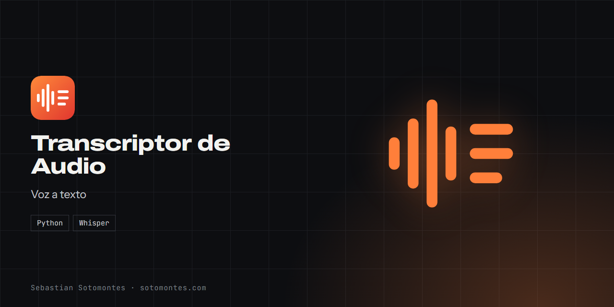
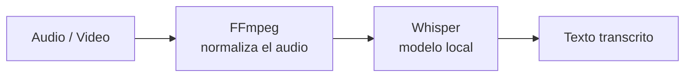

Convierte audio y video a texto con Whisper, en tu propio equipo y sin enviar nada a la nube.

<a href="https://sotomontes.com/#transcriptor-de-audio"><b>Ver en sotomontes.com</b></a> · <a href="#cómo-se-usa">Cómo se usa</a> · <a href="#cómo-funciona-por-dentro">Cómo funciona</a> · <a href="#novedades">Novedades</a>

| Ficha técnica | |
|---|---|
| **Autor** | Sebastian Sotomontes |
| **Tipo** | Voz a texto |
| **Plataforma** | Windows, con Python |
| **Versión** | 1.0 |
| **Estado** | Estable |
| **Stack** | Python · Whisper |
| **Código** | Privado. Esta página es solo una presentación. |

---

## Qué es

Transcriptor de Audio convierte audio y video en texto usando modelos de Whisper que corren en tu propio equipo. Nada se envía a la nube, así que sirve para entrevistas, reuniones o audios sensibles.

## Novedades

- Selección de modelo y progreso en vivo.

## Cómo se usa

1. Abre el programa y elige un archivo de audio o video.
2. Selecciona el modelo: uno pequeño es más rápido y uno grande más preciso.
3. Pulsa transcribir y sigue el progreso. El idioma se detecta solo.
4. Al terminar, copia el texto o guárdalo.

## Funciones

- **Voz a texto** con modelos a elegir según tu equipo.
- **Detección automática** del idioma.
- **Progreso en vivo** durante la transcripción.
- **100 % local y privado**, ideal para audios sensibles.

## Detalles

- La primera vez se descarga el modelo elegido, una sola vez.
- Con tarjeta gráfica la transcripción es mucho más rápida.

## Cómo funciona por dentro

### Cómo funciona

El programa toma tu archivo de audio o video, lo prepara con **FFmpeg** (lo convierte al formato que Whisper espera)
y luego lo pasa por un **modelo de Whisper**, que reconoce el habla y devuelve el texto. Como Whisper corre **en local**,
el procesamiento depende de tu equipo: puedes elegir un modelo más pequeño (rápido) o más grande (más preciso).
La interfaz muestra el progreso y, al terminar, el texto listo para copiar o guardar.

### Tecnologías

- **Python 3** + **Tkinter** (GUI).
- **openai-whisper** sobre **PyTorch** (torch/torchaudio).
- **FFmpeg** para decodificar el audio/video de entrada.

**Créditos:** usa Whisper y FFmpeg.

---

© 2026 Sebastian Sotomontes. Todos los derechos reservados.
